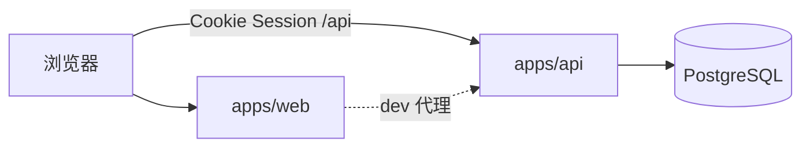

# CourseMatch 仓库架构与目录说明

> **读者：** 组员答辩、联调、新人 onboarding。  
> **仓库：** [github.com/SilenVale/coursematch](https://github.com/SilenVale/coursematch)  
> **与 [ARCHITECTURE.md](../ARCHITECTURE.md) 的区别：** `ARCHITECTURE.md` 是全组**设计契约**（模块、API 形状、禁止事项）；本文描述 **代码里真实的目录、路由、账号切换**，便于「打开仓库就能讲」。

---

## 1. 总览：Monorepo 与运行时

```text
coursematch/
├── apps/
│   ├── web/                 React + Vite 前端
│   └── api/                 Fastify + PostgreSQL 后端
├── packages/
│   ├── shared/              前后端共用类型与 API 契约
│   └── allocation/          主分配算法（纯逻辑，无 HTTP）
├── docs/                    协作、测试、部署（非运行时）
├── docs/downloads/          ← 本说明所在目录（组员查阅区）
├── render.yaml              Render Dev（Postgres + Docker Web）
├── docker-compose.yml       本地 Postgres
└── package.json             npm workspaces
```

**本地开发**

| 进程 | 命令 | 地址 |
| --- | --- | --- |
| 前端 | `npm run dev:web` | http://localhost:5173（`/api` 代理到 API） |
| 后端 | `npm run dev:api` | http://localhost:3001 |

**Render Dev：** 单容器 `SERVE_WEB=1`，API 托管 `apps/web/dist` 静态资源；业务数据在 **Render Postgres**（与本地 Docker 库**不是同一份**）。



---

## 2. 前端架构

### 2.1 目录树

```text
apps/web/
├── index.html
├── vite.config.ts                 dev：/api → localhost:3001
├── public/aeye/                   落地页模板静态资源（CSS/JS/图片）
└── src/
    ├── main.tsx                   BrowserRouter、styles.css、landing.css
    ├── App.tsx                    ★ 总路由（未登录 / 已登录）
    ├── demoAccounts.ts            演示「切换账号」名单（须与后端 demo 一致）
    ├── api/client.ts              login / me / logout、activities 等
    ├── layout/AppShell.tsx        已登录壳：侧栏 + UserMenu
    ├── components/
    │   ├── LoginForm.tsx
    │   └── UserMenu.tsx           切换账号 / 退出 → /login
    ├── pages/
    │   ├── landing/               路径 /
    │   ├── Login.tsx              路径 /login
    │   ├── Home.tsx               路径 /app（按 role 分叉）
    │   ├── teacher/               教师功能（见 §4）
    │   └── student/               学生功能（见 §5）
    ├── styles.css                 工作台 UI
    └── landing.css                落地页隔离样式
```

### 2.2 路由表（URL **不**含账号名）

| 登录态 | URL | 页面 | 说明 |
| --- | --- | --- | --- |
| 否 | `/` | `LandingPage` | 营销落地页 |
| 否 | `/login` | `LoginPage` | 独立登录 |
| 否 | 其它 | → `/login` | |
| 是 | `/app` | `HomePage` | **教师、学生共用同一路径**；`role` 决定渲染 `TeacherHome` 或 `StudentHome` |
| 是 | `/teacher/*` | 教师页 | 非教师 → `/app` |
| 是 | `/student/*` | 学生页 | 非学生 → `/app` |
| 是 | `/`、`/login` | → `/app` | 已登录不再看落地页 |

**身份来源：** 非 URL，而是 **Session Cookie** → `GET /api/auth/me` → `App` 内 `actor` 状态。

### 2.3 演示账号切换（前端）

| 位置 | 行为 |
| --- | --- |
| `demoAccounts.ts` | 5 个 identifier 列表（teacher_blank、20262001…） |
| `LoginForm` | 快捷按钮填 identifier；密码演示统一见 README |
| `UserMenu` | 切换：logout → `/login?prefill=账号`；退出：→ `/login` |

换账号 = **换 Session**，不是换路由前缀；各账号数据在 Postgres 里按 `account_id` 分开存。

---

## 3. 后端架构

### 3.1 目录树

```text
apps/api/src/
├── index.ts                       启动
├── app.ts                         ★ Fastify：CORS/Cookie/CSRF、挂路由、SERVE_WEB 静态前端
├── plugins/csrf.ts
├── lib/
│   ├── session.ts                 Cookie、loadActorBySession
│   ├── response.ts                ok / fail
│   ├── ensure-demo-accounts.ts    Dev 补全演示账号
│   └── provision-student-accounts.ts
├── routes/
│   ├── auth.ts                    POST /api/auth/login, GET me, POST logout
│   ├── role-guard.ts              写接口角色校验
│   ├── assistant.ts               教师选课助理 HTTP
│   ├── catalog.ts                 课种目录
│   └── activities/
│       ├── read.ts                活动列表/详情
│       ├── config.ts              配置总入口
│       ├── config-topics.ts       课种/轮次
│       ├── config-roster.ts       名单、开通学生
│       ├── preferences.ts         学生志愿
│       ├── freeze-allocation.ts   冻结 + 主分配
│       ├── results.ts             教师/学生结果
│       ├── dev-trial.ts           Dev 试跑（可选）
│       └── stubs.ts
├── assistant/                     LLM Agent、工具、teacher-session-db
├── catalog/                       课种归一化
└── db/
    ├── pool.ts, migrate.ts
    ├── migrations/001~008.sql
    └── seed*.ts                   本地演示；Render 默认 RUN_SEED=0
```

### 3.2 请求链（讲解用）

```text
HTTP 请求 + Cookie
  → preHandler: loadActorBySession → req.actor
  → preHandler: demoRoleCheck（写操作按 TEACHER/STUDENT）
  → 路由 handler → SQL（按 account_id、活动归属过滤）
```

### 3.3 与 `packages/` 的关系

| 包 | 职责 |
| --- | --- |
| `packages/shared` | `ActorView`、活动/志愿等 DTO；web 与 api 共同 import |
| `packages/allocation` | `calculate()` 主分配；由 `freeze-allocation` 路由调用 |

---

## 4. 教师端架构

**没有**按账号分的目录（例如不存在 `teacher_blank/` 文件夹）；按 **业务流程** 分文件。

### 4.1 URL ↔ 前端文件

| URL | 主要组件 | 职责 |
| --- | --- | --- |
| `/app` | `TeacherHome.tsx` | 活动列表、新建选课 |
| `/teacher/assistant` | `TeacherAssistantPage.tsx` | DeepSeek 选课助理 |
| `/teacher/courses/new` | `CreateCoursePage.tsx` | 创建活动 |
| `/teacher/courses/:id/overview` | `CourseOverview.tsx` | 概览 |
| `/teacher/courses/:id/configure` | `ActivityConfigPage.tsx` | 配置向导（基础/课种/名单/发布） |
| `/teacher/courses/:id/results` | `FreezeAllocationPage.tsx` | 冻结、主分配、关闭 |

**侧栏（`AppShell` TEACHER_NAV）：** 工作台 `/app`、选课助理 `/teacher/assistant`。

### 4.2 教师页内常用子模块

```text
pages/teacher/
├── TopicPanel.tsx, RosterPanel.tsx, PublishPanel.tsx
├── ActivityBasicsForm.tsx, DevTrialPanel.tsx
├── configApi.ts, freezeApi.ts, devTrialApi.ts
├── assistantSessionApi.ts, assistantSessionStorage.ts
└── configUi.tsx, teacherCourseUi.ts
```

### 4.3 教师主要 API 域（后端）

| 业务 | 路由模块 |
| --- | --- |
| 我的活动、创建 | `read.ts`, `config.ts` |
| 课种/名额 | `config-topics.ts` |
| 名单 CSV、开通学生 | `config-roster.ts` |
| 冻结、分配 | `freeze-allocation.ts` + `packages/allocation` |
| 结果与证据 | `results.ts` |
| 选课助理 | `assistant.ts`, `assistant/*` |
| 助理对话持久化 | DB `assistant_teacher_session`（按 `account_id`） |

**数据归属：** `activity` 绑定创建教师；API 只返回当前 `req.actor` 自己的活动。

---

## 5. 学生端架构

### 5.1 URL ↔ 前端文件

| URL | 组件 | 职责 |
| --- | --- | --- |
| `/app` | `StudentHome`（在 `Home.tsx`） | 选一门已发布活动，再进填报 |
| `/student/preferences` | `PreferencesPage.tsx` | 填报志愿（常带 `?activity=`） |
| `/student/results` | `ResultsPage.tsx` | 查看分配结果 |

**侧栏（STUDENT_NAV）：** 工作台、选课填报、我的结果。

### 5.2 文件

```text
pages/student/
├── PreferencesPage.tsx
├── ResultsPage.tsx
└── student-api.ts
```

### 5.3 学生主要 API（后端）

| 业务 | 路由模块 |
| --- | --- |
| 可见活动 | `read.ts`（已发布 + 在名单内） |
| 填报志愿 | `preferences.ts` |
| 我的结果 | `results.ts`（如 results/me） |

---

## 6. 数据库迁移（与功能对应）

| 迁移 | 内容 |
| --- | --- |
| 001 | account、session、activity 等基础 |
| 002 | topic、作废 |
| 003 | 冻结、分配批次 |
| 004 | 志愿 |
| 005 | 助理站点 LLM 配置 |
| 006 | 助理教师会话 JSON |
| 007 | 课种目录 |
| 008 | 名单导入快照 |

本地 `npm run migrate`；Render 部署时容器启动自动 migrate。**勿对 Render 随意 `SEED_FORCE=1`**，以免清空共用 Dev 数据。

---

## 7. 常见误解（答辩可强调）

| 误解 | 事实 |
| --- | --- |
| 每个演示账号有自己的路由或文件夹 | 共用 `/app`、`/teacher/*`；身份靠 **Session** |
| 合并落地页会删 Render 上 teacher_blank 历史 | 历史在 **Postgres**；仅前端变更 + `RUN_SEED=0` 不会洗库 |
| 本地与 Dev 数据应一致 | **两套库**；Dev 有线上累积操作，本地 seed 默认只有空演示账号 |
| `docs/ARCHITECTURE.md` 与本文重复 | 契约 vs **代码地图**；开发改路由时应同步更新本文 |

---

## 8. 维护说明

- 大改路由、新增顶层 `pages/*` 目录或 API 域时，请在本 PR 中更新本文对应章节。
- 设计边界、禁止事项仍以 [ARCHITECTURE.md](../ARCHITECTURE.md)、[INTERNAL_MODULES.md](../INTERNAL_MODULES.md) 为准。

*文档版本：与落地页 + `/app` 路由分离后的 master 对齐。*
